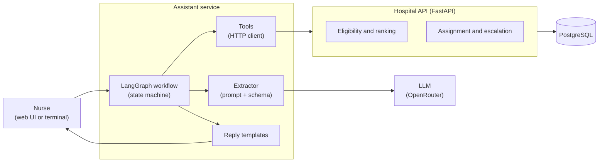
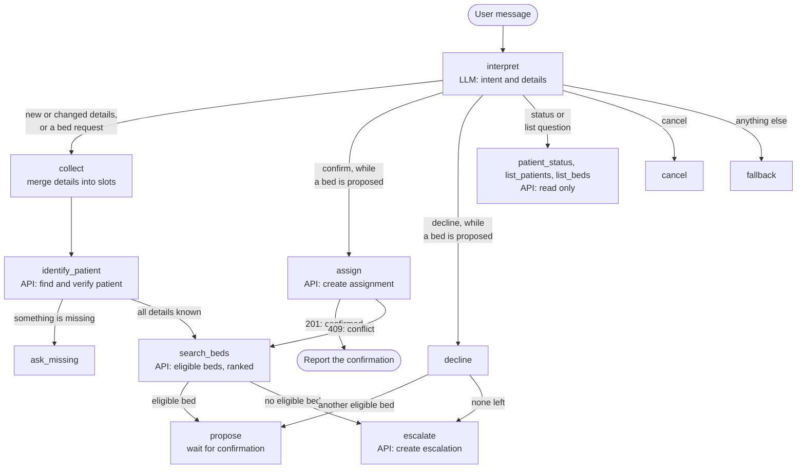
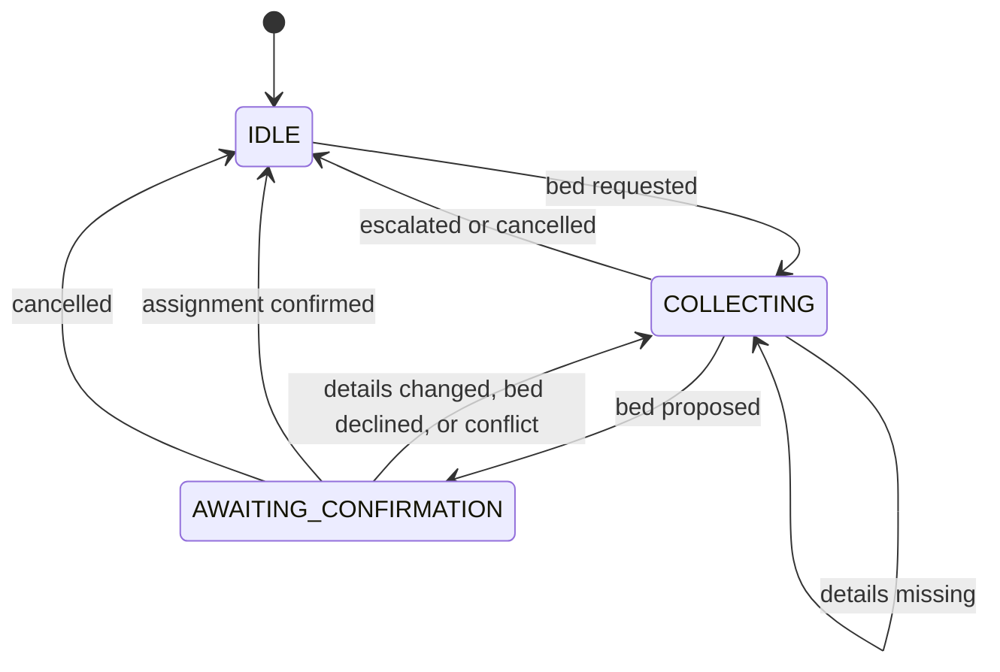

# BedMed: Design

BedMed is a conversational assistant for patient admission and bed assignment. A nurse says what a patient needs; the assistant finds an eligible bed, confirms it with the nurse, assigns it, and escalates to a person when no bed qualifies.

One rule shapes the whole design:

> **The LLM interprets. The workflow decides. Tools act. APIs confirm.**

## Scenario and assumptions

- **User:** a nurse or bed coordinator, typing in a chat.
- **Backend:** a hospital system that owns patients, beds and assignments. Here it is a FastAPI service backed by PostgreSQL, with fictional data.
- **A free bed is not necessarily an eligible bed.** A bed must be in the right kind of ward, in an open ward, available, equipped for the patient's needs, and allowed by the room-sharing policy.
- **The nurse states the patient's needs.** In production most of these would be pre-filled from the health record and only confirmed. Having the nurse state them makes the prototype demonstrate entity capture and clarification.
- **Room sharing is hospital policy, not a universal rule.** The mock hospital uses "same sex" for shared rooms, set per room. If compatibility cannot be determined, a person decides.
- **Nothing is assigned without a human "yes".**

## Architecture

| Concern | Where it lives | Notes |
| --- | --- | --- |
| Understanding language | `assistant/extractor.py`, `assistant/prompts.py` | The only LLM call |
| Conversation logic | `assistant/workflow.py` | Explicit state, pure routing functions |
| Integrations | `assistant/tools.py` | One method per API call; no database access |
| Wording | `assistant/messages.py` | Templates filled from API responses |
| Business rules | `api/eligibility.py` | Deterministic; returns every rejection reason |
| State changes | `api/placement.py` | Transactional; re-validates before writing |
| Data | PostgreSQL | Reached only through the API |

## High-level flow

### Happy path

1. Nurse: "I need a medical bed for patient 1001, nothing special."
2. The LLM extracts the intent (request a bed) and the details (patient, ward type, isolation, monitoring, private room).
3. The workflow confirms the patient exists and has no bed.
4. The workflow asks the API for eligible beds. The API ranks them.
5. The assistant proposes the best bed and waits. Nothing has been written.
6. Nurse: "yes."
7. The workflow asks the API to assign the bed. The API re-checks eligibility inside the transaction and writes the assignment.
8. The assistant reports the confirmation, quoting the API's assignment number.

### Alternate and failure paths

| Situation | What happens |
| --- | --- |
| Details are missing | The assistant asks for all of them in one message and searches only when every detail is known |
| Patient given by name | The name is looked up. One match is used; none or several are reported and the nurse chooses, by number, name or ID |
| Unknown patient | The assistant says so and asks again |
| Patient already has a bed | The assistant reports the bed and assigns nothing |
| No eligible bed | The assistant creates an escalation, says no bed was assigned, and gives the reasons. Requirements are never relaxed |
| Bed taken between proposal and "yes" | The API returns `409`. The assistant says so, searches again, and proposes the next bed or escalates |
| Nurse changes a detail after a proposal | The proposal is discarded and the search runs again |
| Nurse declines the bed | The next eligible bed is offered; when none is left, the request escalates |
| LLM unavailable or returns invalid output | The assistant says so. State is unchanged |
| Hospital API unavailable | The assistant says nothing was assigned and never reports success |
| Off-topic or manipulative message | Treated as not understood; any pending question is repeated |

## Conversation model

The conversation is a graph (LangGraph). It runs once per user message and stops; state is saved between messages. This keeps every decision point visible and testable.

Every path ends by sending a reply and waiting for the next message. If the LLM or the API fails at any step, the path ends there with a reply that says what was not done.

A live version of this graph, drawn from the running code, is on the Workflow page of the UI.

### Stages

The request in progress is always in one of three stages:

### State

| Field | Meaning |
| --- | --- |
| `stage` | `IDLE`, `COLLECTING` or `AWAITING_CONFIRMATION` |
| `slots` | The five details collected so far; each is unknown until stated |
| `patient` | The patient record as confirmed by the API |
| `patient_options` | Patients shown in a numbered list when a name was ambiguous |
| `candidates` | Eligible beds from the last search, in ranked order |
| `proposed_bed_id`, `declined_bed_ids` | The bed on offer and the beds turned down |
| `rejection_summary` | Why near-miss beds were rejected; used for the escalation reason |

### How each step does its work

| Kind | Nodes |
| --- | --- |
| LLM | `interpret` |
| API tool | `identify_patient`, `search_beds`, `assign`, `escalate`, `patient_status`, `list_patients`, `list_beds` |
| Plain logic | `collect`, `ask_missing`, `propose`, `decline`, `cancel`, `fallback` |

## Intents and entities

### Intents

| Intent | Example | Effect |
| --- | --- | --- |
| Request a bed | "I need a tele bed for P-1002" | Starts or restarts a placement request |
| Provide information | "no isolation, and she can share" | Fills or corrects details |
| Confirm | "yes, go ahead" | Assigns the proposed bed |
| Decline | "not that one" | Offers the next eligible bed |
| Patient status | "where is Helen Brooks?" | Read-only lookup |
| List patients | "who is still waiting?" | Read-only list |
| List beds | "which beds are free?" | Read-only list |
| Cancel | "never mind" | Clears the request |
| Unknown | anything else | Asks again; changes nothing |

### Entities

| Entity | Type | Required for a search | Notes |
| --- | --- | --- | --- |
| Patient ID | text | Yes | Normalised ("1001" becomes "P-1001") and verified with the API |
| Patient name | text | No | Only a way to find the ID |
| Ward type | medical, telemetry, ICU, surgical | Yes | |
| Isolation required | yes / no | Yes | |
| Monitoring required | yes / no | Yes | |
| Private room required | yes / no | Yes | |
| Choice number | number | No | Position picked from a numbered list the assistant showed |
| Has-bed filter | yes / no | No | For listing patients |
| Bed-status filter | available, occupied, cleaning, reserved, out of service | No | For listing beds |

An unstated detail stays unknown and is asked for. It is never assumed to be "no", and the API rejects a search that omits any of the four needs.

## Where AI is used

### At run time

| Task | Done by | Why |
| --- | --- | --- |
| Reading the message: intent and details | LLM, with output constrained to a schema | Language is varied; this is what LLMs are good at |
| Deciding the next step | Code | Must be predictable and testable |
| Deciding which beds are eligible | Code, in the API | A safety rule; must give the same answer every time |
| Changing hospital state | The API | Single source of truth, transactional |
| Writing the reply | Templates | A sentence saying "assigned" can only be produced after the API confirms |

### Prompt design

- **One job.** The model converts one message into a fixed schema. It is told it does not answer the user or decide anything.
- **Context.** The model is told what the assistant last asked, so a bare "no" is read as the answer to that question.
- **No guessing.** Unstated details are returned as null, and one detail is never inferred from another.
- **Positions, not identities.** For "the first one", the model returns the number 1; code maps it to the patient that was shown.
- **Message as data.** The user's text is fenced in tags and the model is told to treat it as content to interpret, not instructions.
- **Examples.** A short set of worked examples covers each intent and the context-dependent cases.

### In building this

AI assistants were used throughout development, and this is stated plainly:

- The project's working agreement (`CLAUDE.md`) was drafted with ChatGPT.
- The code, tests and documents were written with Claude Code, working from that agreement. Each stage was planned, reviewed and approved before it was built, and every stage was verified by running the tests and the application.

## Design decisions and trade-offs

| Decision | Benefit | Cost |
| --- | --- | --- |
| LLM extracts only; no tool calling by the model | The model cannot take or claim an action | Less flexible than an agent; new behaviour needs new code |
| Template replies | Statements of fact are tied to API results | Less natural phrasing |
| Explicit graph, run once per message | Every path can be drawn, traced and tested | More structure than a simple loop |
| Eligibility in the API, re-checked at assignment | No double booking; stale searches are harmless | The rules run twice |
| All four needs must be stated | No silent assumptions about a patient | More questions for the nurse |
| A real database with row locks | The conflict path is real, and tested with concurrent requests | Heavier than a stub |

## Known limitations

- Conversation state is held in memory and lost on restart.
- There is no authentication or user identity, and the UI is a local demonstration.
- The eligibility rules are a small, illustrative set, not clinical guidance.
- Extraction accuracy has been checked by hand, not yet by an automated evaluation set.
- Policy retrieval (RAG) is designed but not built; see the scalability notes.
- All data is fictional. The system does not process real health information and makes no compliance claims.
